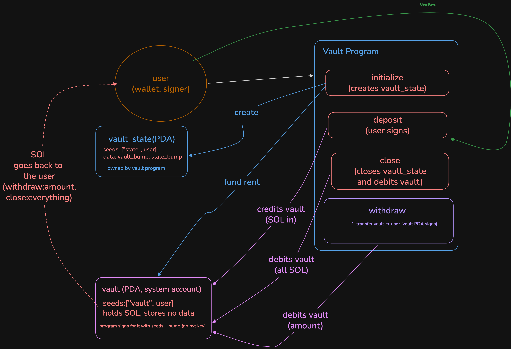
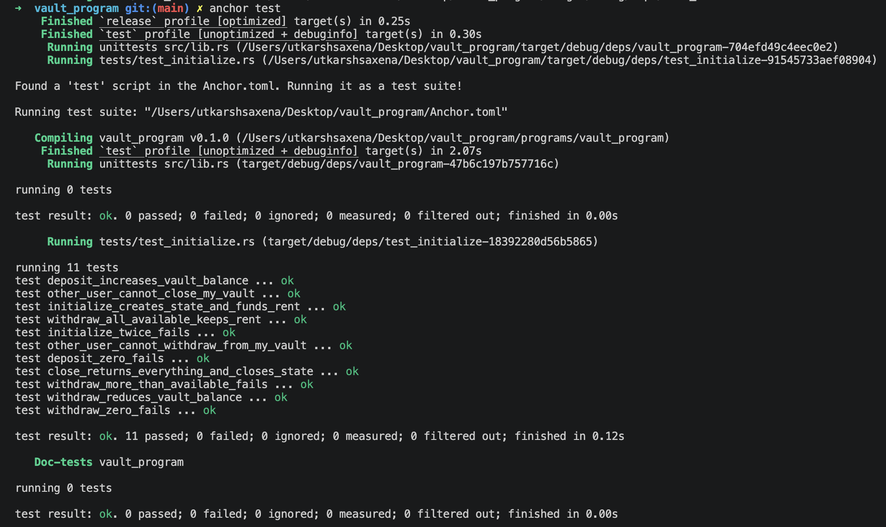

# Vault Program

A per-user SOL vault on Solana, written with Anchor. Each user gets their own vault that only they can deposit into, withdraw from and close. The vault is a PDA owned by the System Program, so the program can move its SOL only by signing with the PDA seeds, and it only does that for the vault's owner.

**Program ID:** `9SSgnW19ei83NWSNCikxwzXNdiGtN5Z6zbj46KKAy1CV`

| | |
|---|---|
| Framework | Anchor 1.x (`anchor-lang 1.1.2`) |
| Tests | Rust + [LiteSVM](https://github.com/LiteSVM/litesvm) |
| Rust toolchain | 1.89.0 (pinned in `rust-toolchain.toml`) |
| Asset | Native SOL (lamports) |

---

## Table of contents

1. [Architecture](#architecture)
2. [Accounts and PDAs](#accounts-and-pdas)
3. [State](#state)
4. [Instructions](#instructions)
5. [Errors](#errors)
6. [Security notes](#security-notes)
7. [Tests](#tests)
8. [Build and run](#build-and-run)
9. [Project structure](#project-structure)
10. [Roadmap](#roadmap)

---

## Architecture



<!-- TODO: add the architecture diagram at docs/images/vault-architecture.png -->

Every user has two PDAs, both derived from the user's public key:

- **`vault_state`** is a data account owned by this program. It stores the two bumps, so later instructions don't have to search for them.
- **`vault`** is a system-owned account that holds the SOL and no data. The program can't edit its lamports directly, so it asks the System Program to move them, signing with the vault's seeds and bump through `invoke_signed`.

The flow:

1. `initialize` creates `vault_state` and funds the vault with the rent-exempt minimum.
2. `deposit` moves SOL from the user to the vault. The user signs, so no PDA signature is needed.
3. `withdraw` moves SOL from the vault back to the user. The vault PDA signs.
4. `close` moves everything out of the vault and closes `vault_state`.

---

## Accounts and PDAs

| Account | Seeds | Owner | Holds | Created by |
|---|---|---|---|---|
| `vault_state` | `["state", user]` | Vault program | `vault_bump`, `state_bump` | `init` in `initialize` |
| `vault` | `["vault", user]` | System Program | SOL only, no data | The address exists up front. It's funded with rent in `initialize`. |

Both seeds include the user's key, so one user can never address another user's vault. If someone passes another user's PDAs, the seed check fails.

Seed constants live in `constants.rs`:

```rust
pub const VAULT_SEED: &[u8] = b"vault";
pub const STATE: &[u8] = b"state";
```

---

## State

```rust
#[account]
#[derive(InitSpace)]
pub struct VaultState {
    pub vault_bump: u8,
    pub state_bump: u8,
}
```

Space is the 8-byte Anchor discriminator plus 2 bytes of fields.

---

## Instructions

### `initialize()`

Creates the user's vault.

- **Accounts:** `user` (signer, mut), `vault_state` (init), `vault` (mut), `system_program`.
- **Effects:**
  - Creates `vault_state` with `init`, paid by the user.
  - Transfers the rent-exempt minimum for a zero-data account from the user to the vault.
  - Saves `vault_bump` and `state_bump` into `vault_state`.
- **Fails if:** the vault was already initialized, since `init` fails on an existing account.

### `deposit(amount: u64)`

Adds SOL to the vault.

- **Accounts:** `user` (signer, mut), `vault_state`, `vault` (mut), `system_program`.
- **Checks:** `amount > 0`, and both PDAs match their seeds and saved bumps.
- **Effects:** `system_program::transfer` from the user to the vault.

### `withdraw(amount: u64)`

Takes SOL out of the vault.

- **Accounts:** same as `deposit`.
- **Checks:**
  - The vault holds at least the rent-exempt minimum.
  - `0 < amount <= vault_balance - rent_exempt`. The vault always keeps its rent-exempt minimum, so it never gets garbage collected.
- **Effects:** `system_program::transfer` from the vault to the user, signed by the vault PDA with `[VAULT_SEED, user, vault_bump]`.

### `close()`

Closes the vault and returns everything.

- **Accounts:** `user` (signer, mut), `vault_state` (mut, `close = user`), `vault` (mut), `system_program`.
- **Effects:**
  - Transfers the vault's entire lamport balance (deposits plus rent) to the user, signed by the vault PDA.
  - Closes `vault_state` through the `close = user` constraint, and its rent goes back to the user.

---

## Errors

| Error | Message | Raised when |
|---|---|---|
| `InvalidAmount` | Deposit amount must be greater than zero | `deposit` is called with `amount == 0` |
| `InvalidWithdrawAmount` | Deposit amount must be less than or equal amount in vault | `withdraw` is called with `amount == 0` or more than the available balance |

---

## Security notes

- **Only the owner can touch a vault.** Both PDAs are seeded with the signer's key, so an attacker who signs and passes someone else's vault fails the seed constraint.
- **No private key for the vault.** The vault is a PDA. Funds move only through the program, using the seeds and bump.
- **Rent protection.** `withdraw` never takes the vault below the rent-exempt minimum. Only `close` empties it.
- **Saved bumps.** Bumps are stored in `vault_state` and checked with `bump = vault_state.vault_bump`, which avoids re-deriving them on every call.

---

## Tests

Tests are written in Rust with LiteSVM. They load the compiled program (`target/deploy/vault_program.so`) into an in-process SVM, so no local validator is needed.

| Test | What it checks |
|---|---|
| `initialize_creates_state_and_funds_rent` | `vault_state` exists and the vault holds exactly the rent-exempt minimum |
| `initialize_twice_fails` | A second `initialize` for the same user is rejected |
| `deposit_increases_vault_balance` | The vault balance goes up by the deposited amount |
| `deposit_zero_fails` | `amount = 0` is rejected and the balance is unchanged |
| `withdraw_reduces_vault_balance` | The vault balance goes down by the withdrawn amount |
| `withdraw_all_available_keeps_rent` | Withdrawing all available SOL leaves the rent-exempt minimum |
| `withdraw_more_than_available_fails` | Overdrawing is rejected and the balance is unchanged |
| `withdraw_zero_fails` | `amount = 0` is rejected and the balance is unchanged |
| `other_user_cannot_withdraw_from_my_vault` | An attacker signing against someone else's vault is rejected |
| `other_user_cannot_close_my_vault` | An attacker can't close someone else's vault or state |
| `close_returns_everything_and_closes_state` | `vault_state` is closed, the vault is empty, and the user gets the SOL back |

### Test output



<!-- TODO: add a screenshot of `cargo test` passing at docs/images/vault-tests.png -->

---

## Build and run

```bash
# build the program (produces target/deploy/vault_program.so)
anchor build

# run the LiteSVM tests (the build above must come first)
cargo test
```

Requirements: Rust 1.89.0 (installed automatically by `rust-toolchain.toml`), the Solana CLI, and Anchor 1.x.

---

## Project structure

```
programs/vault_program/
├── src/
│   ├── lib.rs               # program entrypoints
│   ├── constants.rs         # PDA seeds
│   ├── error.rs             # custom errors
│   ├── state.rs             # VaultState
│   └── instructions/
│       ├── initialize.rs
│       ├── deposit.rs
│       ├── withdraw.rs
│       └── close.rs
└── tests/
    └── test_initialize.rs   # LiteSVM tests
```

---

## Roadmap

Planned advanced extension: a non-custodial pooled vault with shares, where users can redeem in kind for an underlying market position even when the vault has no idle liquidity. It will be a separate program in this workspace, so this one stays as it is.